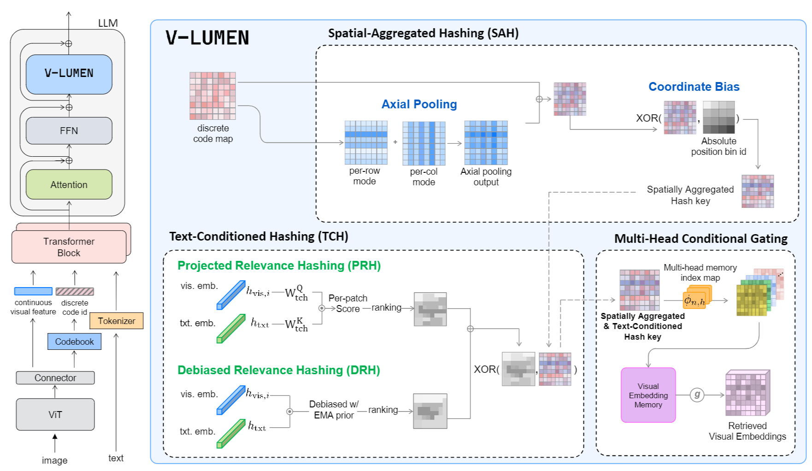

# V-LUMEN: Visual Lookup Memory for Embedding Scaling in Vision-Language Models

**Miso Choi\*, Daekeun Kim\*, Eunji Kim, Jungbeom Lee** · NeurIPS 2026 · [arXiv:2610.37019](https://arxiv.org/abs/2610.37019)

Official PyTorch implementation of **"V-LUMEN: Visual Lookup Memory for Embedding Scaling
in Vision-Language Models"**, accepted at **NeurIPS 2026**.

V-LUMEN adds a large, sparsely read **visual lookup memory** to a frozen vision-language model.
Visual features are discretized with a frozen codebook, turned into spatially aware and
text-conditioned hash keys, and the retrieved memory rows are fused into the backbone
through a gated residual. All addressing is non-parametric, and a lookup costs the same
whatever the table size, so capacity grows in storage rather than in per-token compute.

This repository contains the code to train and evaluate V-LUMEN on Qwen3-VL-2B-Instruct
and to reproduce the main results of the paper (Tab. 1–3), plus the seed-1 checkpoints
of all Tab. 2 settings.

### Motivation

Dense scaling grows capacity and per-token compute together. A lookup memory (e.g.,
Engram for text) reads one row per token, so capacity grows while compute per token
stays constant. V-LUMEN brings this to vision-language models, whose visual features
are continuous, spatially structured and query-dependent rather than discrete tokens.

<p align="center"></p>

### Overview

<p align="center"></p>

## Method in one paragraph

At the input of the backbone, each visual token is mapped to a codebook ID by a frozen
random projection and the frozen LaVIT codebook (**§2.2**). On the 8×8 grid of IDs,
**Spatial Aggregation-based Hashing** (SAH, §2.3) blends row/column summaries (axial
pooling) and a coarse position bucket (coordinate bias) into each key, and
**Text-Conditioned Hashing** (TCH, §2.4) XORs a per-patch text-relevance bin computed
from the question (PRH, DRH, or their ensemble). Each of the 2 n-gram orders × 8 heads =
16 **memory cells** hashes the key to one row of its table (81,920+ rows each); the rows
are fused after decoder layers 2 and 8 by **Multi-Head Conditional Gating** (one sigmoid
gate per cell), a depthwise convolution and RMSNorm, as a scaled residual (§2.5).
Only the memory rows and the fusion parameters are trained.

## Setup

Tested with Python 3.12, PyTorch 2.11 and one NVIDIA RTX 6000 Ada (48 GB).

```bash
git clone https://github.com/miso-choi/V-Lumen.git && cd V-Lumen

# with uv
uv venv --python 3.12 && source .venv/bin/activate
uv pip install -r requirements.txt

# or with venv + pip
python3.12 -m venv .venv && source .venv/bin/activate
pip install -r requirements.txt
```

The backbone (`Qwen/Qwen3-VL-2B-Instruct`), the LaVIT codebook (`rain1011/LaVIT-7B-v2`,
only the visual-tokenizer file) and all datasets are downloaded from the Hugging Face Hub
on first use. Set `HF_HOME` to a disk with enough space (training data + benchmarks ≈ 60 GB).

## Checkpoints

Seed-1 checkpoints of every Tab. 2 setting (SFT stage, ~0.35–0.5 GB each):

| File | Setting | Trainable modules |
|---|---|---|
| `vlumen_only_seed1.pt` | V-LUMEN-only | V-LUMEN (86.1M) on the frozen backbone |
| `lora_only_seed1.pt` | LoRA-only = LoRA(1+k) | LoRA rank 321 (128.9M) |
| `lora_vlumen_seed1.pt` | LoRA + V-LUMEN = LoRA(k) + V-LUMEN(1) | LoRA rank 107 + V-LUMEN |
| `moe_only_seed1.pt` | MoE-only = MoE(1+k) | 31 experts × 344, top-1 (131.2M) |
| `moe_vlumen_seed1.pt` | MoE + V-LUMEN = MoE(k) + V-LUMEN(1) | 21 experts × 168, top-1 + V-LUMEN |

```bash
python scripts/download_checkpoints.py        # -> checkpoints/*.pt (SHA-256 verified)
```

Google Drive folder: _link to be added_.

## Reproducing the paper

| | Command | Needs | Time (1 GPU) |
|---|---|---|---|
| Tab. 1 | `bash scripts/reproduce_tab1.sh` | nothing | ~1 min |
| Tab. 2 (released checkpoints) | `bash scripts/reproduce_tab2.sh` | `checkpoints/` | ~2 h per setting |
| Tab. 2 (from scratch, 3 seeds) | `bash scripts/reproduce_tab2.sh train` | — | ~10 h training per seed + eval |
| Tab. 3 | `bash scripts/reproduce_tab3.sh` | `checkpoints/vlumen_only_seed1.pt` | ~1 h |

Evaluation scores the trained model and the vanilla backbone in the same pass; add
`--no_vanilla` to `scripts/evaluate.py` to halve the time.

### Training a single setting

```bash
bash scripts/train_and_eval.sh vlumen 1        # V-LUMEN-only, seed 1
bash scripts/train_and_eval.sh lora_vlumen 1   # LoRA(k) + V-LUMEN(1)
# settings: vlumen | lora | lora_vlumen | moe | moe_vlumen
```

This runs mid-training → SFT → evaluation and writes everything to `runs/<setting>_seed<seed>/`.
The two stages can also be run directly:

```bash
python scripts/train.py --stage midtrain --setting vlumen --steps 10000 --seed 1 --out runs/v/midtrain.pt
python scripts/train.py --stage sft --init runs/v/midtrain.pt --steps 2000 --seed 1 --out runs/v/sft.pt
python scripts/evaluate.py --ckpt runs/v/sft.pt --benchmarks reasoning     # or: zero_shot
python scripts/summarize.py runs/*/eval_reasoning.json                      # mean ± std table
```

Budget matching (App. G) is automatic: from the V-LUMEN parameter count `P_v` and
`--budget_scale k` (default 0.5), the LoRA rank and the MoE shape (experts, hidden size,
top-k) are derived so that LoRA-only / MoE-only match LoRA + V-LUMEN / MoE + V-LUMEN.

### Training recipe

| | Mid-training | SFT |
|---|---|---|
| Data | DocVQA, ChartQA, InfographicVQA, GQA, RefCOCO, AI2D, A-OKVQA, TextCaps, ScienceQA (with lecture) | ScienceQA, AI2D, DocVQA, ChartQA, GQA, A-OKVQA |
| Rows per source | 6,000 | 4,000 (10% held out) |
| + few-shot split | 10% of each reasoning benchmark (≤ 200 per benchmark) | same |
| Steps (V-LUMEN-only / adapter settings) | 10,000 / 2,000 | 2,000 / 1,000 |
| Batch size | 4 | 8 |
| LR (adapters, fusion) | 4e-4 | 1e-4 |
| LR (memory rows) | 5 × LR | 0.1 × LR |
| Schedule | cosine to 0.1 × LR | cosine to 0.05 × LR |

AdamW (weight decay 0.1; 0 for memory rows, norms and the residual scale), bf16 backbone,
fp32 V-LUMEN / adapters, answer-only loss, gradient clipping per V-LUMEN module at
√(memory_dim / 128) = 2 and at 1.0 for LoRA / MoE. On one RTX 6000 Ada, V-LUMEN-only takes
about 3 h (mid-training) + 1 h (SFT); each adapter setting about 50 min + 50 min.

## Results

Numbers from the camera-ready paper. "Released" rows are what the seed-1 checkpoints in
this repository give with this code.

**Tab. 1 — Lookup latency vs. memory-table size** (one fusion layer, 64 visual tokens,
bf16, RTX 6000 Ada, mean over 50 runs; relative to the default 1×)

| Rows / cell | Table params | Memory | Lookup total (ms) | Gather only (ms) |
|---|---|---|---|---|
| 16,384 (0.2×) | 8,433,472 | 16.9 MB | 11.22 ± 0.15 (1.005×) | 0.463 (0.983×) |
| 81,920 (1×) | 41,976,448 | 84.0 MB | 11.16 ± 0.11 (1.000×) | 0.471 (1.000×) |
| 327,680 (4×) | 167,825,792 | 335.7 MB | 11.16 ± 0.11 (1.000×) | 0.462 (0.981×) |
| 655,360 (8×) | 335,605,248 | 671.2 MB | 11.23 ± 0.21 (1.006×) | 0.491 (1.042×) |

**Tab. 2 — Accuracy (%) on five reasoning benchmarks** (mean ± std over three seeds;
Avg Δ = average gain over the vanilla backbone, pp)

| Setting | ChartMus. | FRIEDA | VisRes | MMMU | MMMU-Pro | Avg | Avg Δ |
|---|---|---|---|---|---|---|---|
| Vanilla | 1.69 | 2.27 | 5.00 | 1.63 | 0.30 | 2.18 | – |
| V-LUMEN-only | 16.70 ± 0.79 | 4.77 ± 0.23 | 24.50 ± 2.07 | 33.38 ± 0.95 | 20.50 ± 0.82 | 19.97 ± 0.47 | +17.79 ± 0.47 |
| LoRA-only | 17.87 ± 0.28 | 5.53 ± 0.13 | 22.03 ± 0.50 | 41.87 ± 1.47 | 26.50 ± 1.93 | 22.76 ± 0.85 | +20.58 ± 0.85 |
| LoRA + V-LUMEN | 18.24 ± 0.41 | 5.61 ± 0.35 | 21.70 ± 2.39 | 41.91 ± 1.30 | 29.20 ± 0.66 | 23.33 ± 0.02 | +21.15 ± 0.02 |
| MoE-only | 13.48 ± 0.90 | 4.85 ± 0.35 | 23.53 ± 3.87 | 33.21 ± 2.22 | 20.10 ± 0.26 | 19.03 ± 0.95 | +16.85 ± 0.95 |
| MoE + V-LUMEN | 14.19 ± 0.49 | 4.70 ± 1.02 | 25.07 ± 1.43 | 32.54 ± 1.17 | 19.00 ± 2.59 | 19.10 ± 0.91 | +16.92 ± 0.91 |

Released seed-1 checkpoints (the seed-1 runs of the paper, evaluated with this code):

| Setting | ChartMus. | FRIEDA | VisRes | MMMU | MMMU-Pro | Avg | Avg Δ |
|---|---|---|---|---|---|---|---|
| V-LUMEN-only | 15.88 | 4.77 | 26.70 | 34.38 | 20.70 | 20.49 | +18.31 |
| LoRA-only | 17.91 | 5.45 | 22.10 | 42.16 | 26.10 | 22.74 | +20.57 |
| LoRA + V-LUMEN | 18.69 | 5.68 | 19.60 | 42.66 | 29.90 | 23.31 | +21.13 |
| MoE-only | 12.61 | 4.55 | 21.20 | 31.74 | 19.90 | 18.00 | +15.82 |
| MoE + V-LUMEN | 14.41 | 3.64 | 23.50 | 31.24 | 18.20 | 18.20 | +16.02 |

Retraining all five settings from scratch with this code (seed 1) gives averages of
19.29 / 22.24 / 23.04 / 19.71 / 19.28, within the seed-to-seed variation above. The
memory-table initialisation was not seeded in the original runs, so retrained numbers
are not bit-identical to the released checkpoints.

**Tab. 3 — Zero-shot accuracy (%)** of V-LUMEN-only on benchmarks outside the training
curriculum (frozen backbone, no few-shot samples, images disjoint from training data)

| Benchmark | Vanilla | + V-LUMEN (3 seeds) | Released seed 1 |
|---|---|---|---|
| TextVQA | 11.00 | 37.17 ± 3.42 (+26.17) | 34.90 |
| OCR-VQA | 13.80 | 47.67 ± 0.76 (+33.87) | 46.80 |
| VizWiz-VQA | 2.00 | 9.97 ± 1.84 (+7.97) | 8.40 |

Evaluation protocol: held-out 90% of each benchmark under a fixed split seed (42), up to
1,000 examples, greedy decoding with at most 32 new tokens, 224×224 images, relaxed
accuracy (numbers within 5% relative error; otherwise exact match after normalising case,
punctuation and whitespace; MMMU answers are reduced to the option letter).

## Code structure

```
vlumen/
  config.py         VLumenConfig: every setting of the paper; stored in each checkpoint
  codebook.py       frozen codebook: random projection + LaVIT nearest-code lookup (§2.2)
  memory_table.py   memory cells, SAH (axial pooling, coordinate bias) and TCH salting (§2.3–2.5)
  fusion.py         VLumenModule: lookup + Multi-Head Conditional Gating + residual fusion
  model.py          VLumenVLM: hooks on the frozen Qwen3-VL; TCH relevance (PRH / DRH)
  moe.py            routed MoE adapter for the MoE baselines
  budget.py         parameter-budget matching for LoRA / MoE (App. G)
  checkpoint.py     model construction and checkpoint I/O
  evaluation.py     greedy generation and relaxed accuracy
  data/
    mixture.py      mid-training and SFT data mixtures
    benchmarks.py   evaluation benchmarks and the few-shot split
    collate.py      answer-only loss masking
scripts/
  train.py                     one training stage (midtrain | sft)
  evaluate.py                  evaluate a checkpoint (reasoning | zero_shot | list)
  benchmark_lookup_latency.py  Tab. 1
  summarize.py                 eval JSONs -> Markdown table
  download_checkpoints.py      released checkpoints
  train_and_eval.sh            midtrain -> SFT -> eval for one setting / seed
  reproduce_tab{1,2,3}.sh
```

How the pieces connect at inference (prefill; decode steps reuse the KV cache):

```
input tokens ─► Qwen3-VL decoder
   layer 0  (pre-hook)   visual hidden states ──frozen codebook──► code IDs
   layer 2  (pre-hook)   question & patch states ──PRH/DRH──► relevance bins (TCH)
   layer 2  (post-hook)  VLumenModule: SAH+TCH keys → 16 memory cells → gated residual
   layer 8  (post-hook)  VLumenModule (own memory)                          [+ MoE adapter]
```

## Notes

- Visual Genome is listed in the paper's mid-training data, but it was not loaded in the
  runs behind the released checkpoints; the mixture here matches those runs (see
  `vlumen/data/mixture.py`).
- `--seed` fixes both the initialisation and the data order. Training on different GPUs
  or library versions is not bit-identical; across our three seeds the Avg Δ spread is
  given in Tab. 2.

## Citation

```bibtex
@inproceedings{choi2026vlumen,
  title     = {V-LUMEN: Visual Lookup Memory for Embedding Scaling in Vision-Language Models},
  author    = {Choi, Miso and Kim, Daekeun and Kim, Eunji and Lee, Jungbeom},
  booktitle = {Advances in Neural Information Processing Systems},
  year      = {2026}
}
```

## License

The code and the released checkpoints are available for **noncommercial use only**
(research, education, personal and nonprofit use) under the
[PolyForm Noncommercial License 1.0.0](LICENSE). Commercial use is not permitted.
For commercial licensing inquiries, please contact the authors.

The backbone (Qwen3-VL-2B-Instruct), the LaVIT codebook and the datasets are not part of
this repository and are subject to their own licenses.
